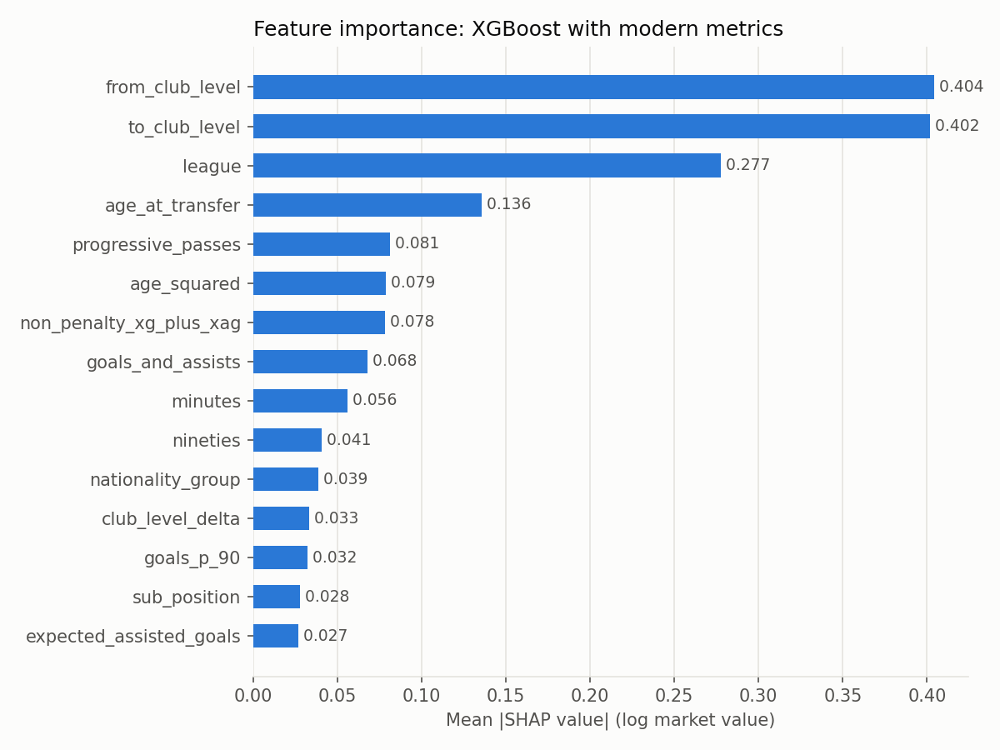

# Football transfer market valuation with machine learning

Predicts a footballer's Transfermarkt market value at the moment of a transfer
from the previous season's FBref statistics and the strength of the two clubs
involved. Transfers from ten leagues (2018 to 2025) are joined to FBref player
seasons, and a 3 x 2 factorial study compares Ridge, Random Forest and XGBoost,
each with and without modern metrics such as xG, on a time-aware split: train
on 2018 to 2024, test on the 1,413 transfers of 2025. Final-year project
(Durham, 2025 to 2026), cleaned up and audited after submission. The submitted
paper is in [paper/](paper/) as a PDF, with a note on what the audit found
after submission.

## Headline result

**XGBoost with modern metrics: test R squared 0.816 on 1,413 held-out 2025
transfers, against 0.290 for a per-league-mean baseline.** The median
absolute error is about EUR 1.1m, and 77.7% of predictions land within a
factor of two of the real value.

| Test R squared (2025) | Traditional stats | With modern metrics |
|---|---|---|
| Ridge | 0.799 | 0.804 |
| Random Forest | 0.787 | 0.786 |
| XGBoost | 0.808 | **0.816** |

Baselines: global mean -0.004, per-position mean 0.005, per-league mean 0.290.
Full metrics (MAE, RMSE, per position, SHAP) are in
[results/metrics.md](results/metrics.md), and the effect of every fix is in
[results/fix_log.md](results/fix_log.md).

## What the factorial study shows

95% confidence intervals from a paired bootstrap (1,000 resamples of the 2025
test set, seed 42; details in [results/metrics.md](results/metrics.md)):

| Difference in test R squared | Observed | 95% CI | Distinguishable from zero? |
|---|---|---|---|
| XGBoost minus Ridge (with modern) | +0.011 | +0.001 to +0.022 | Yes, but barely |
| Modern metrics, Ridge | +0.005 | +0.001 to +0.008 | Yes |
| Modern metrics, Random Forest | -0.001 | -0.004 to +0.002 | No |
| Modern metrics, XGBoost | +0.008 | +0.004 to +0.012 | Yes |

- **Model family:** XGBoost beats Ridge, but only by about 0.01, and the lower
  end of the interval is almost zero. Once club strength is measured properly, a
  scaled linear model gets most of the way.
- **Modern metrics (xG and similar):** they add a small, real gain for Ridge
  and XGBoost (under 0.01 R squared) and nothing measurable for Random Forest.
- **Scope:** the intervals capture sampling variation in the 2025 test set only,
  not variation from retraining or from choosing a different test season.



## Pipeline

- **Load** (`src/load.py`): Transfermarkt transfers, 496,606 dated valuations and
  player profiles; the FBref player-season file.
- **Clean** (`src/clean.py`): drop the FIFA columns, rebuild season totals from
  per-90 values, remove duplicate rows, turn inf into NaN, and drop rows with more
  matches or minutes than a team can play in that league season.
- **Merge** (`src/merge.py`): join each transfer to the FBref season before it
  on Unicode-normalised name, season and birth year (within one year); drop
  ambiguous namesakes. 7,741 of 54,698 transfers match (14.15%).
- **Features** (`src/features.py`): age, club level of both clubs from
  valuations dated in the 12 months before the transfer, position flags and
  position x stat interactions, per-90 and efficiency features. 6,706 transfers
  with 450+ minutes remain.
- **Train** (`src/train.py`): nine cells, the six main ones plus three
  buyer-agnostic ones, tuned by 5-fold random search on the training seasons;
  XGBoost early-stops on 2024 and refits on all training seasons, so 2025 is
  never seen before scoring.
- **Evaluate** (`src/evaluate.py`): baselines, metrics, per-position table, SHAP.
- **Backtest** (`src/backtest.py`): expanding-window out-of-sample predictions,
  one XGBoost fit per season and feature set, scored on that season.
- **Analyse** (`analysis/`): DuckDB star schema (`build_db.py`), one SQL file
  per question (`sql/`), CSV outputs (`output/`), Power BI export and spec
  (`export_powerbi.py`, `POWERBI_SPEC.md`).

## How to run

```bash
python -m venv .venv
source .venv/bin/activate          # Windows: .venv\Scripts\activate
pip install -r requirements.txt

# put the four source CSVs in data/raw/ as described in data/README.md
python -m src.train                # raw data -> dataset -> 9 models -> results/
python -m src.train --skip-data    # retrain and report from data/final only
python -m pytest                   # 30 tests, synthetic data only, a few seconds

# phase 3: fees against a buyer-agnostic valuation
python -m src.backtest             # expanding-window predictions -> data/final
python -m analysis.build_db        # DuckDB star schema -> analysis/transfers.duckdb
python -m analysis.run_queries     # SQL questions -> CSVs in analysis/output/
python -m analysis.export_powerbi  # star schema CSVs for Power BI
```

The full training run takes 20 to 30 minutes on a laptop, almost all of it
hyperparameter search (nine cells now: six main plus three buyer-agnostic).
Seeds are fixed and versions pinned, so the same data gives the same
numbers. `python -m src.early_stopping_check` reruns the early-stopping
comparison, and `python notebooks/build_walkthrough.py` rebuilds the
[walkthrough notebook](notebooks/walkthrough.ipynb).

## Debugging story

The submitted project reported XGBoost R squared 0.72. Auditing the code before
publishing it found these problems, each fixed in its own commit and rerun:

1. **Namesakes merged in the source data.** The FBref file has one row per name
   per season across all leagues, so different players called "Fernando" were
   summed into one row with 89 matches. Joining on name alone attached their
   stats to the wrong transfers. Fix: join on name, season and birth year, drop
   ambiguous matches and physically impossible rows. R squared rose (0.718 to
   0.737) because the noise was removed.
2. **Position flags always zero (silent bug).** The code checked for FBref codes
   such as "GK" and "FW", but the column held Transfermarkt labels ("Goalkeeper",
   "Attack"). All 4 flags and 20 interaction features were zero in every row.
3. **Contract feature built from the future (silent bug).** It first compared a
   2025 contract snapshot with transfers back to 2018; the replacement used the
   date of the player's next transfer, which is unknown at transfer time, and
   was built differently for training rows (81% from the next transfer) and test
   rows (73% from the snapshot). No point-in-time contract data exists, so the
   feature was removed. Removing it did not lower the score.
4. **Club strength measured with today's squads.** `current_club_id` in the
   valuations is the club at scrape time, constant across each player's history,
   so a club's 2019 level was built from its 2025 squad. Rebuilding club spells
   from the transfer history and using only valuations from the 12 months before
   each transfer lifted R squared from 0.742 to 0.816. To rule out leakage, the
   window was moved back a full year: the score barely changed (Ridge 0.798 vs
   0.796).
5. **Early stopping.** The tuned path already early-stopped on 2024, not on the
   test season; a test now checks this. The untuned path could not run at all
   (early stopping with no validation set) and was fixed. Early-stopping on the
   test set instead would have added at most 0.003.

## Limitations

- **Coverage.** Only 14% of Transfermarkt transfers match an FBref season, so the
  model covers players with recent minutes in the ten leagues (Premier League,
  La Liga, Bundesliga, Serie A, Ligue 1, Eredivisie, Primeira Liga, Belgian Pro
  League, Super Lig, MLS), not the wider market.
- **Target.** The target is Transfermarkt's market value, a crowd estimate, not
  the fee paid. The model learns how Transfermarkt values players.
- **Club levels.** Club strength is the strongest signal. It can only use
  valuations of players with a recorded transfer (32% of valuations).
- **Namesakes.** Rows where two namesakes stay under the match and minute caps
  cannot be detected.
- **One test season.** Results rest on a single 2025 season.

## Who overpays: fees against a buyer-agnostic valuation

The main model knows the buying club, so a fee above its prediction can simply
mean "a rich club bought a good player". The Phase 3 analysis asks a sharper
question: which clubs and leagues pay over the odds, and who sells cheap.

**Method.** A buyer-agnostic XGBoost variant drops `to_club_level` and
`club_level_delta` (test R squared 0.763 against 0.816 for the main model,
[results/metrics.md](results/metrics.md)), so its prediction says what the
player is worth regardless of who buys. An expanding window refits both
variants per season on earlier seasons only and predicts every transfer from
2020 to 2025 out of sample ([src/backtest.py](src/backtest.py); per-season
check in [results/backtest_r2.md](results/backtest_r2.md)). The premium is
ln(fee) minus the buyer-agnostic predicted log value, over 1,813 paid deals,
in a DuckDB star schema ([analysis/build_db.py](analysis/build_db.py)); every
number below is a CSV in [analysis/output/](analysis/output/).

**Findings.**

- **Buying clubs** (10+ paid deals): Barcelona top the list with a median
  premium of +1.08 log and 90% of deals above the valuation, then Inter
  (+1.03), Man Utd (+0.96, above the valuation on all 18 paid deals),
  Liverpool (+0.92), Man City (+0.92), Bayern Munich (+0.90), Chelsea (+0.87),
  Paris SG (+0.87).
- **Buying leagues**: Premier League buyers pay a median +0.56 log, about 75%
  above the valuation, with 80% of deals above it; Ligue 1 and Serie A follow
  at +0.13. Eredivisie buyers pay least (-0.56), MLS second least (-0.51).
- **Selling leagues**: MLS (-0.57) and Super Lig (-0.18) sell cheapest
  relative to value; Premier League sells dearest (+0.31, 69% of deals above
  the valuation).
- **Age and position**: the premium falls monotonically with age, from +0.71
  log under 21 (fees about double the valuation) through +0.17 at 21 to 23 and
  +0.14 at 24 to 26, to -0.27 at 27 to 29, -0.43 at 30 to 32 and -0.47 at 33
  and over. Midfielders are cheapest relative to value (-0.06); goalkeepers
  cost the most over the odds (+0.28 on only 96 deals).
- **Where the model errs** ([07_residual_by_league.csv](analysis/output/07_residual_by_league.csv)
  and the other residual files): it underpredicts Bundesliga players by a mean
  0.145 log and overpredicts Eredivisie ones by 0.076, and its shrinkage is
  largest by value band: +0.51 log for players over EUR 30m, -0.45 log under
  EUR 1m. Premiums at the extremes of the value range should therefore be
  read within value bands, not only in the aggregate.

**Limitations.** Market value is a crowd estimate, not ground truth. Fees are
recorded for 6,187 of the 6,706 model rows, and add-ons and loan fees are not
separated in the source. Club and league rankings need 10+ paid deals to be
meaningful. A club's league is a proxy (its most common selling league), and
the selling league is the league of the previous season. The Power BI report
spec for these numbers is in [analysis/POWERBI_SPEC.md](analysis/POWERBI_SPEC.md).

**CV lines.** "Compared 1,813 paid transfer fees (2020 to 2025) against an
out-of-sample buyer-agnostic XGBoost valuation: Premier League buyers pay a
median 75% over the odds, and the premium falls monotonically with age, from
double the valuation under 21 to 38% below at 33+." "Shipped the analysis as a
rebuildable DuckDB pipeline with one SQL file per question and a Power BI
report spec."

## Next steps

- Test the frozen models on 2026 transfers. Blocked until a 2025-26 FBref
  season and 2026 fees exist in the sources.

## Data

The raw files are not included: see [data/README.md](data/README.md) for the
two Kaggle sources (CC0 and MIT), the snapshot hashes and the expected layout.
A 200-row sample of the final modelling table is in
[data/sample/](data/sample/transfers_sample.csv).
