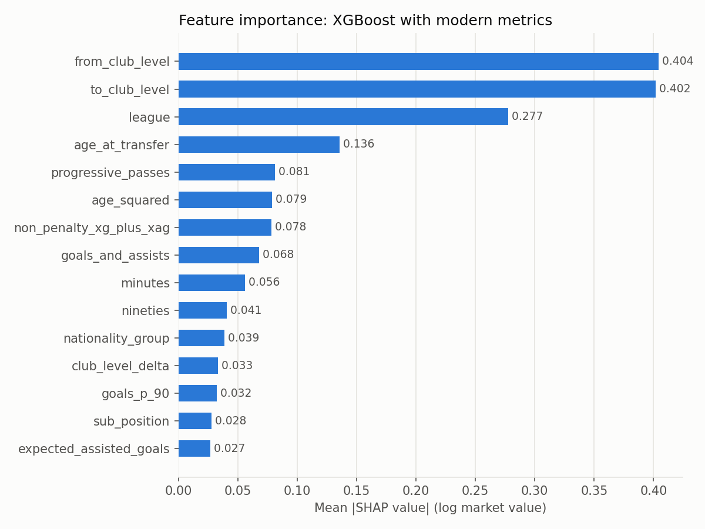
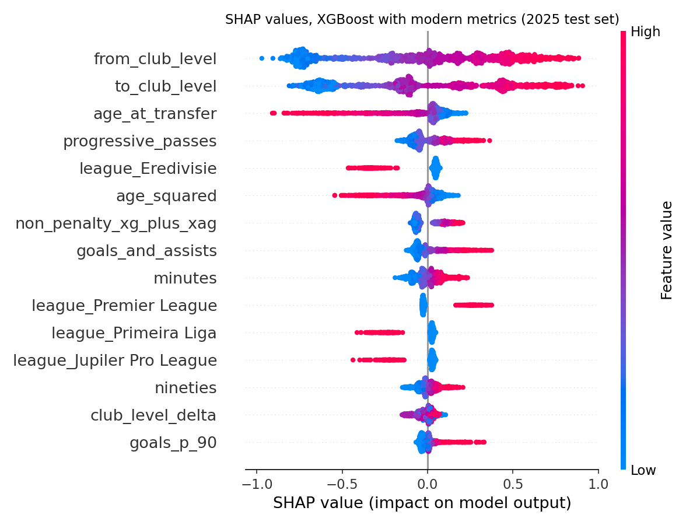

# Results

Test set: 1,413 transfers in the 2025 season. Training set: 5,293 transfers in earlier seasons. Target: log(1 + Transfermarkt market value at transfer). R squared, MAE and RMSE are on that log scale; the median absolute error is in euros.

Regenerate with `python -m src.train` (full pipeline) or `python -m src.evaluate` (report only).

## 3 x 2 factorial, test set

| Model | Features | Test R squared | MAE | RMSE | Median abs. error |
|---|---|---|---|---|---|
| Ridge | Traditional | 0.799 | 0.471 | 0.604 | EUR 1.14m |
| Ridge | With modern | 0.804 | 0.466 | 0.597 | EUR 1.19m |
| Random Forest | Traditional | 0.787 | 0.481 | 0.623 | EUR 1.13m |
| Random Forest | With modern | 0.786 | 0.483 | 0.625 | EUR 1.16m |
| XGBoost | Traditional | 0.808 | 0.460 | 0.592 | EUR 1.05m |
| XGBoost | With modern | 0.816 | 0.452 | 0.579 | EUR 1.09m |

## Trivial baselines (fit on training seasons)

| Baseline | Test R squared | MAE | RMSE |
|---|---|---|---|
| Global mean | -0.004 | 1.093 | 1.352 |
| Per-position mean | 0.005 | 1.091 | 1.346 |
| Per-league mean | 0.290 | 0.906 | 1.138 |

## Test R squared by position

| Position | n | Ridge traditional | Ridge with modern | Random Forest traditional | Random Forest with modern | XGBoost traditional | XGBoost with modern |
|---|---|---|---|---|---|---|---|
| Goalkeeper | 93 | 0.690 | 0.696 | 0.684 | 0.682 | 0.728 | 0.719 |
| Defender | 471 | 0.791 | 0.804 | 0.780 | 0.782 | 0.802 | 0.816 |
| Midfield | 398 | 0.775 | 0.775 | 0.770 | 0.773 | 0.794 | 0.800 |
| Attack | 451 | 0.840 | 0.839 | 0.818 | 0.810 | 0.831 | 0.838 |

## Are the differences real? Bootstrap confidence intervals

Paired bootstrap: 1,000 resamples of the 1,413 test transfers (seed 42); both models in a comparison are scored on the same resample. 95% percentile intervals for the difference in test R squared.

| Comparison | Observed difference | 95% CI | Resamples above zero | Distinguishable from zero |
|---|---|---|---|---|
| XGBoost modern minus Ridge modern | +0.011 | [+0.001, +0.022] | 98.6% | Yes |
| Ridge: with modern minus traditional | +0.005 | [+0.001, +0.008] | 99.9% | Yes |
| Random Forest: with modern minus traditional | -0.001 | [-0.004, +0.002] | 31.6% | No |
| XGBoost: with modern minus traditional | +0.008 | [+0.004, +0.012] | 100.0% | Yes |

## SHAP: XGBoost with modern metrics

Mean absolute SHAP value on the test set, one-hot levels summed back to their source feature.

| Rank | Feature | Mean abs. SHAP |
|---|---|---|
| 1 | from_club_level | 0.404 |
| 2 | to_club_level | 0.402 |
| 3 | league | 0.277 |
| 4 | age_at_transfer | 0.136 |
| 5 | progressive_passes | 0.081 |
| 6 | age_squared | 0.079 |
| 7 | non_penalty_xg_plus_xag | 0.078 |
| 8 | goals_and_assists | 0.068 |
| 9 | minutes | 0.056 |
| 10 | nineties | 0.041 |

## Data join

Denominator: all 54,698 Transfermarkt transfers in the 2018 to 2025 seasons.

| Stage | Transfers | Share |
|---|---|---|
| FBref match on name + previous season | 8,039 | 14.70% |
| ... and birth year within 1 year | 7,749 | 14.17% |
| ... and unambiguous (match rate) | 7,741 | 14.15% |
| Model rows (450+ minutes, target and age present) | 6,706 | 12.26% |

See [fix_log.md](fix_log.md) for how each fix changed these numbers.
